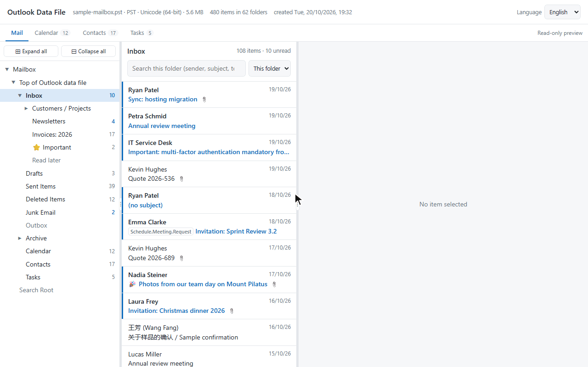
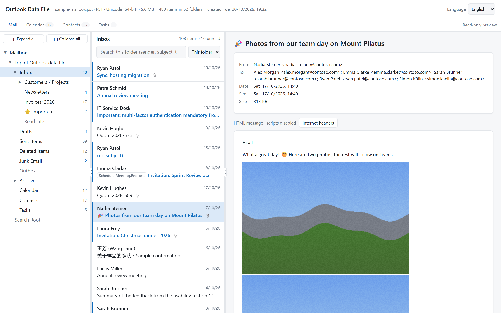
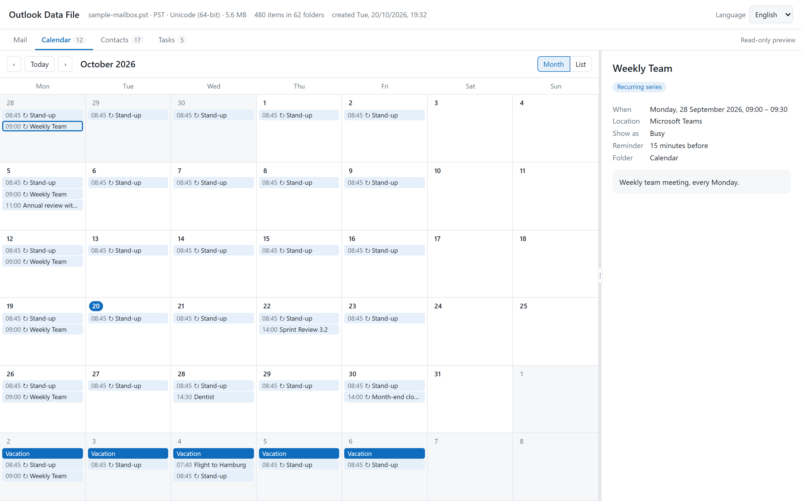
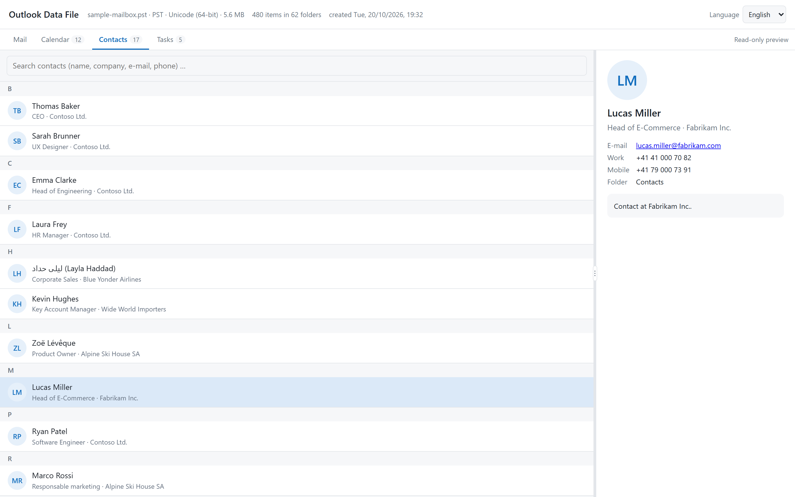

# OST & PST Rescue

**Look inside Outlook data files and take your mail, calendar and contacts with you – no Outlook required.**

OST & PST Rescue turns Outlook `.ost` and `.pst` files into open formats: a private, offline web page you can browse
like a mailbox, plus standard export files that any mail, calendar and contacts app can import.

> [!CAUTION]
> **Use at your own risk – please verify everything.**
> This project was largely *vibe-coded*, i.e. written with the help of an AI coding assistant. It is tested, but there is
> **no guarantee that your data is reconstructed completely or correctly**, and **no liability** is accepted for lost,
> incomplete or damaged data (see the [license](LICENSE)).
>
> - **Before** you export or import anything, open the HTML viewer and check that all folders, mails, appointments and
>   contacts you expect are there and look right.
> - **After** importing into your new provider or app, check again that everything arrived – compare folder by folder.
> - **Keep your original `.ost` / `.pst` file** until you are sure nothing is missing.



**▶ [Try the live demo in your browser](https://flogy.github.io/ost-pst-rescue/demo/)** – no installation needed.
*The demo uses an invented sample mailbox – all names, companies and messages are fictitious.*

---

## What can it do?

- 🔍 **Look inside** – Open an OST/PST file as a web page: folder tree, mail list, reading pane with attachments, a
  **calendar** (month and list view), **contacts** and **tasks**. Read-only – nothing is ever changed.
- 📤 **Take it with you** – Export **mail** to mbox (keeping the folder structure as labels, like Google Takeout), the
  **calendar** and **tasks** to iCalendar (`.ics`) and **contacts** to vCard (`.vcf`).
- 🔒 **Stays on your computer** – Everything runs locally. No upload, no account, no tracking. The viewer blocks
  scripts in mails and only loads external images when you ask for it.
- 📦 **Handles big files** – Tested with a 1 GB mailbox with 14,000+ items; memory use stays low.
- 🗓️ **Finds the gaps** – Shows how many mails exist per month – handy to spot that Outlook only kept the last
  12 months offline.
- 🌍 **Speaks your language** – Viewer in English and German, more languages can be added easily
  ([how](locales/README.md)).

### Typical situations

- You are **switching email providers** and the migration tool missed some mails.
- You have an **old laptop** or backup with an `.ost`/`.pst` file but no Outlook (or no access to the old account).
- You want to **archive** an old mailbox in a format that will still open in 20 years.
- You simply want to **see what is in** that 1 GB file before deleting it.

---

## Quick start (no programming knowledge needed)

### 1. Install Node.js (one time)

OST & PST Rescue runs on [Node.js](https://nodejs.org), a free program that runs JavaScript on your computer.

- Go to **[nodejs.org](https://nodejs.org)**, download the **LTS** version for your system and install it with the default settings.
- Works on **Windows, macOS and Linux**. Node.js 18 or newer is required.

### 2. Download OST & PST Rescue

- On this GitHub page click the green **Code** button → **Download ZIP**, then unzip it (e.g. to your Desktop).
- *Or*, if you use git: `git clone` this repository.

### 3. Open a terminal in that folder

- **Windows:** open the unzipped folder in Explorer, right-click an empty spot → **Open in Terminal**.
- **macOS:** open *Terminal*, type `cd ` (with a space), drag the folder into the window and press Enter.

Then install the one dependency (only needed once):

```bash
npm install
```

### 4. Find your Outlook file

> **Close Outlook first** – it locks its data file while it is running.

| File | Usual location |
|---|---|
| `.ost` (Microsoft 365, Exchange, Outlook.com accounts) | Windows: `C:\Users\<you>\AppData\Local\Microsoft\Outlook\` |
| `.pst` (archives, exports, POP accounts) | Windows: `Documents\Outlook Files\` |

Copy the file into the OST & PST Rescue folder (working on a copy is safest).

### 5. Look inside

```bash
node rescue.js view "your-file.ost"
```

This creates a folder `your-file_html`. Open `index.html` in it with your browser – that's your mailbox.
Check that everything you expect is there (see the warning above).

### 6. Export

```bash
node rescue.js export "your-file.ost" --single --gmail-labels
```

This creates:

| File | Contains | Import into |
|---|---|---|
| `your-file.mbox` | all mails, each tagged with its folder | Thunderbird, Apple Mail, providers with an mbox import (e.g. Infomaniak) |
| `your-file.calendar.ics` | appointments incl. recurring series | Google Calendar, Apple Calendar, Outlook, Thunderbird, … |
| `your-file.tasks.ics` | tasks | apps with task (VTODO) support, e.g. Thunderbird |
| `your-file.contacts.vcf` | contacts | Google Contacts, Apple Contacts, Outlook, … |

At the end the tool prints a summary of **what went where and what was not exported** (for example contact groups,
which have no standard format). Read it!

Then import the files into your new provider or app and **check the result** – folder by folder.

---

## Try it without your own data

The repository contains an invented sample mailbox, so you can try everything safely:

```bash
npm run sample                                  # creates sample-mailbox.ost and sample-mailbox.pst
node rescue.js view sample-mailbox.pst           # -> sample-mailbox_html/index.html
node rescue.js export sample-mailbox.pst --single --gmail-labels
```

A ready-made viewer export of the sample is online as a [live demo](https://flogy.github.io/ost-pst-rescue/demo/), and
in [`docs/demo/`](docs/demo/) (open `docs/demo/index.html` after downloading the repository).

| Mail | Calendar | Contacts |
|---|---|---|
|  |  |  |

---

## Commands in detail

Everything runs through one command, `rescue.js`, for OST and PST files alike.
`node rescue.js --help` lists the commands, `node rescue.js <command> --help` their options.

### `view` – browse a mailbox

```bash
node rescue.js view <file.ost|pst> [output-folder] [options]
```

| Option | Meaning |
|---|---|
| `--force` | overwrite an existing output folder |
| `--no-attachments` | list attachments by name only (much smaller output) |
| `--max-inline-kb N` | largest inline image embedded in a message (default 3072) |

The viewer is a static web page that works straight from disk (`file://`), also offline. Columns can be resized,
folders searched (or *all* folders at once), and the language switched at the top right.

### `export` – mail, calendar, tasks and contacts

```bash
node rescue.js export <file.ost|pst> --list                 # show the folder tree with item counts
node rescue.js export <file.ost|pst> [output] [options]
```

| Option | Meaning |
|---|---|
| `--single` | one mbox file instead of one per folder |
| `--gmail-labels` | add the folder path as `X-Gmail-Labels` header, so importers recreate your folders |
| `--include "<pattern>"` | only these folders, e.g. `--include "Inbox/Projects/**"` (repeatable) |
| `--exclude "<pattern>"` | skip folders, e.g. `--exclude "Deleted Items/**"` (repeatable) |
| `--label-strip <path>` / `--label-prefix <path>` | adjust the folder labels to match your target mailbox |
| `--mail-only` | do not write calendar, task and contact files |
| `--no-attachments` | leave out attachment content |
| `--force` | overwrite existing output |

Folder patterns: `*` = any characters within one level, `**` = any levels, `X/**` = X and all subfolders;
matching is case-insensitive.

### `dates` – are old mails missing?

```bash
node rescue.js dates <file.ost|pst> [--folders]
```

Prints how many mails exist per month (only dates are read). If the history stops abruptly about a year ago, Outlook
only kept recent mail offline – the older mail is only on the server. In classic Outlook set *File → Account
Settings → (your account) → Mail to keep offline* to **All**, let it synchronise, and convert again.

---

## What is exported, and what not

| Outlook item | Viewer | Export |
|---|---|---|
| Mails incl. attachments, inline images, forwarded mails as attachments | ✅ | ✅ mbox |
| Folder structure | ✅ | ✅ as labels (`--gmail-labels`) or one mbox per folder |
| Appointments incl. recurring series, deleted and moved occurrences, reminders, time zones | ✅ | ✅ iCalendar |
| Tasks | ✅ | ✅ iCalendar (VTODO) |
| Contacts | ✅ | ✅ vCard 3.0 |
| Meeting requests and responses | ✅ | ✅ as mail |
| Contact groups, notes, journal entries | ✅ (in the mail tab) | ❌ no common standard format – listed in the summary |
| Encrypted (S/MIME) mails | ⚠️ not decrypted | ⚠️ not decrypted; the encrypted part is exported as an attachment – not specifically tested |

**Known limitations**

- Changed occurrences of a recurring series keep their new time, subject and location, but not individually edited notes.
- Search in the viewer covers sender, recipients and subject, not the message text.
- Password-protected or damaged files and very old ANSI PST files (Outlook 97–2002) are not specifically tested.

---

## Contributing

Bug reports and pull requests are welcome. Please never attach real mailbox files to an issue – use the sample
mailbox (`npm run sample`) to reproduce problems where possible.

- **Tests:** `npm test` generates the sample mailbox as OST and PST, reads every item back, checks all exports and
  the viewer data. It runs automatically on every push (Windows, macOS, Linux).
- **Translations:** add a file to [`locales/`](locales/README.md).
- **Demo:** `npm run demo` rebuilds the viewer in [`docs/demo/`](docs/demo/) from the sample mailbox.

### Project structure

| Path | Purpose |
|---|---|
| `rescue.js` | command line: `view`, `export`, `dates` |
| `lib/mailbox.js` | opening OST/PST files, walking folders and items, shared helpers |
| `lib/pst-fixes.js` | fixes for [pst-extractor](https://github.com/epfromer/pst-extractor) (current Outlook files, large folders, forwarded messages) |
| `lib/view.js`, `lib/viewer/` | HTML viewer: export of the data, and the static page (HTML, CSS, JavaScript) |
| `lib/export.js`, `lib/mime.js` | mbox export: folder selection and labels, MIME message building |
| `lib/pim.js` | appointments (incl. recurrence and time zones), tasks and contacts → iCalendar / vCard |
| `lib/dates.js` | mails per month |
| `locales/` | viewer translations |
| `sample/` | fictitious sample mailbox: content, attachments, and a writer for the binary OST/PST format |
| `test/run.js` | end-to-end test |
| `docs/` | screenshots, demo GIF and the demo viewer |

## Credits

- [pst-extractor](https://github.com/epfromer/pst-extractor) reads the OST/PST files. OST & PST Rescue adds fixes for
  current Outlook files (compressed 4K-page OSTs, large folders, forwarded messages).
- File format details follow Microsoft's open specifications
  [MS-PST](https://learn.microsoft.com/openspecs/office_file_formats/ms-pst/) and
  [MS-OXOCAL](https://learn.microsoft.com/openspecs/exchange_server_protocols/ms-oxocal/).

Outlook, Microsoft 365 and Exchange are trademarks of Microsoft Corporation. This project is not affiliated with or
endorsed by Microsoft.

## License

[MIT](LICENSE) – free to use, change and share. Provided "as is", without warranty of any kind.
